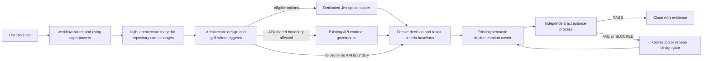

# Architecture Review Feature Implementation Blueprint

Status: Draft v0.1; rollout tracking updated after local router and CLI integration.  
Purpose: Turn the approved review flow and criteria into a minimal integration plan. The local capability entrypoint, global routing overlay, and Jev scorer CLI exist; CI enforcement remains disabled. The phase 1 code-change pilot is still pending.

## 1. Current environment findings

The inspected global workspace already provides most of the routing and specialist pieces:

| Existing component | Observed role and implementation implication |
|---|---|
| agents/workflow-router.toml | Top-level advisory router. It owns routing decisions, validation tiers, and a separate optional Jev routing preflight. Architecture review is loaded through `required_skill_overlays` and does not replace the production executor. |
| skills/using-superpowers/agent-routing-rules.yaml | Canonical route rules. It already routes API contract review to api-contract-governance and attaches that skill to API implementation work. Keep those API-specific routes intact. |
| agents/api-contract-guardian.toml | Existing specialist for cross-application contract and architecture conformance. Use only when a relevant boundary is affected; do not create a second equivalent reviewer. |
| skills/api-contract-governance/SKILL.md | Existing contract workflow compares declared rules to code evidence and reports PASS/FAIL/UNKNOWN. It forbids uploading source to remote MCPs. |
| .local-trials/jev-api/jev_client.py and jev_architecture_scorer.py | The dependency-free client remains the HTTP transport; the scorer exposes a stdin/stdout CLI that the workflow invokes when viable options and data-policy conditions are met. It validates response completeness and score math. |
| .local-trials/jev-api/jev_router.py | Optional global routing preflight. Keep it separate from the architecture option scorer; do not reuse routing confidence as option fit. |
| .local-trials/jev-api/tests | Client and router tests remain, and `test_jev_architecture_scorer.py` covers the normalized score contract using a stub and a mocked HTTP boundary. |
| capabilities/architecture-review | The local `SKILL.md` entrypoint and review documents exist. The global router loads it by the declared overlay catalog; the registry dispatch schema was not expanded. |
| capabilities/registry.json and capabilities/sync-policy.json | Capability registration and sync classification are explicit. architecture-review is not registered. Unknown/company context requires manual sync approval under the current policy. |

The practical consequence: substantive repository code changes now receive automatic lightweight impact/reuse triage, and eligible architecture grills invoke the scorer automatically. Persistent review records, CI gates, and the real-project pilot remain pending.

## 2. Recommended system shape

Architecture review is a **cross-cutting gate**, not a replacement for the selected implementation owner.

### Ownership

- **workflow-router / using-superpowers:** decide whether lightweight architecture triage applies and select the existing semantic executor. Preserve its route authority and validation-tier policy.
- **architecture-review entrypoint:** apply the review format, discover local evidence, determine impact/depth, assemble grill options, create the frozen decision and criteria baselines, and prepare the post-change review record.
- **architect-deep:** support material cross-module design or unresolved architecture choices. It does not execute production code or own final acceptance.
- **existing implementation owner:** implement the selected design. Examples remain the current code-change, frontend, or domain-specific owner.
- **api-contract-governance / api-contract-guardian:** conditional support when a public/shared API, event, schema, or provider/consumer boundary is affected. Keep the implementation workflow as primary.
- **Jev option scorer:** one typed advisory evaluation after evidence-backed options exist. It is not an agent and never approves the design.
- **acceptance_process:** apply the frozen result criteria after implementation. Use an independent reviewer when the existing validation contract requires one.

Do not add a dedicated always-on architecture worker in v1. A single capability skill plus a router overlay uses the current architecture without creating another competing agent.

## 3. Routing and trigger integration

### Entry policy

1. For substantive source-code construction, addition, modification, deletion, or refactor in an existing project, automatically run lightweight triage before implementation. The triage may conclude that no formal grill is needed.
2. For questions, documentation-only work, or mechanical edits with no behavior/contract impact, skip the code-change triage unless the user asks for architecture review.
3. Determine operation type and affected boundaries from repository evidence, not from the verb in the request alone.
4. Keep the existing semantic implementation route primary. Architecture review adds a workflow node/overlay; it does not steal code ownership.
5. Escalate to architect-deep for material architecture design. Attach API contract governance only for relevant contract boundaries.
6. Calculate the impact score after repository discovery. The top-level router must not invent a score from the request text.

### Routing output extension

At initial routing, emit only whether triage is required and the next node. After discovery, the architecture-review record holds:

- operation type: construct / modify / add / delete
- architecture score and evidence by dimension
- review depth: no_formal_grill / focused_grill / full_grill
- override triggers and reasons
- reuse-search coverage and candidate decision
- current node and gate state

Suggested workflow nodes: architecture_triage, architecture_grill, criteria_baseline, implementation, result_review, closed. The capability skill owns detailed procedures; the top-level router should reference it rather than copy its rubric.

### Existing rule alignment

- Keep api_contract_change as the pre/post contract overlay for API implementation work.
- Keep api_contract_review for API/boundary conformance investigations. Ensure generic architecture-review requests do not accidentally route to the API-only path without API/boundary signals.
- Apply `required_skill_overlays: [architecture-review]` to general code changes, API changes, bug fixes, code implementation plans, and code-diff reviews. Keep each route's existing semantic primary owner and API-contract support.

## 4. Review record and handoff contract

V1 needs no external database. Keep the active review record in the current task/work artifact; do not write generated review files into a project repository by default. Persist a durable ADR only when the decision changes long-lived project architecture and that repository has an ADR convention.

The record should carry:

- review ID and record version
- requested outcome, scope, non-goals, constraints, and operation type
- affected modules, architecture evidence references, reusable candidates, call sites, and tests inspected
- impact score, review depth, override triggers, and grill decisions
- Jev status and validated per-option values, if eligible
- selected design, ownership, allowed dependency changes, and contract/lifecycle decisions
- criteria baseline version and status: READY_FOR_IMPLEMENTATION / NEEDS_CLARIFICATION / BLOCKED
- change revision/diff reference
- per-criterion result: PASS / FAIL / NOT_RUN / BLOCKED / EXEMPTED, evidence, and findings
- final result: PASS / FAIL / BLOCKED, accepted risks, owner, and residual assumptions

### Handoffs

| Handoff | Required payload |
|---|---|
| Triage → architecture design | User outcome, operation, affected area, evidence coverage, score/depth, and trigger reasons. |
| Architecture design → implementation owner | Chosen option, bounded scope, module owner, contract/dependency/lifecycle decisions, frozen change-specific criteria, required evidence, and unresolved non-blocking assumptions. |
| Architecture design → Jev | Only the sanitized scoring-interface request with short summaries and opaque evidence IDs. Never source code, raw diffs, secrets, customer data, or full conversation. |
| Architecture design / implementation → API contract reviewer | Sanitized contract description, provider/consumer references, declared architecture rules, and the specific semantic/compatibility question. |
| Implementation owner → acceptance process | Exact changed revision/diff, decision and criteria baseline versions, test/check results, and known gaps. |
| Acceptance process → user | PASS/FAIL/BLOCKED, criterion IDs, evidence, findings, required correction, and residual risk. |

## 5. Jev scorer implementation boundary

The existing generic JevClient is the HTTP transport. The local scorer at `.local-trials/jev-api/jev_architecture_scorer.py` is invoked by the workflow through stdin/stdout and:

- live beside the existing client during the local trial, with a separate module and command/function from jev_router.py
- accept only the normalized architecture-option-score.v1 request
- reject ineligible and policy-blocked requests before network I/O
- sanitize before sending, batch all candidate score questions in one request, and map answer IDs back to option IDs
- validate answer type, complete option coverage, score/confidence ranges, probability keys and sums, and rubric legend
- normalize provider/network/configuration errors to the defined status values and fail open for the overall architecture workflow
- emit only validated values and minimal operational metadata; never log credentials or raw context
- use the existing JEV environment configuration; do not create another HTTP client or add a dependency without a demonstrated need

The router's optional Jev routing preflight remains an independent call with a different purpose and schema. Do not combine its choice/noul answers with architecture score answers.

## 6. Rollout plan

| Phase | Deliverable | Gate to proceed |
|---|---|---|
| 0. Specification | Existing review format, scoring interface, workflow, result criteria, and this implementation blueprint. | User approves the design direction and any remaining policy choices. |
| 1. Local capability | The concise `capabilities/architecture-review/SKILL.md` entrypoint, Goldfish trigger/role matrix, and reference docs exist. Routing applies them to code changes, code reviews, and qualifying long-lived software designs. A fresh-context reviewer pilot is still pending; no CI enforcement. | Review records are understandable; selected lenses cover triggered dimensions; no missing decision/criteria handoff; false grill triggers are manageable. |
| 2. Local Jev scorer | Implemented in `.local-trials/jev-api/jev_architecture_scorer.py`; mock tests cover valid scores, incomplete/extra options, malformed probabilities, API failures, data-policy rejection, and the existing HTTP client boundary. | **Met locally:** normalized results satisfy the contract and invalid/unavailable responses produce no scores. |
| 3. Router/capability registration | The global route rules and router prompt attach the architecture-review overlay to substantive code changes, API changes, bug fixes, implementation plans, code-diff reviews, qualifying long-lived software designs, and explicit independent design-review requests. Goldfish runs only under existing grill thresholds/overrides or explicit design-review requests; existing primaries and API/security/compliance gates are preserved, and the registry dispatch schema was not expanded. | A real pilot confirms no-grill, focused/full grill, role mapping, domain boundaries, explicit requests, and non-code exclusions behave as intended. |
| 4. Pilot | Apply the workflow to one bounded repository; record false positives/negatives, missing reuse candidates, time/cost, and result-review disagreements. | Thresholds and prompts are adjusted from evidence; no automatic merge blocker yet. |
| 5. Optional CI adoption | Add only project-native deterministic checks: existing tests, API schema/compat checks, architecture rules, and duplication tooling where useful. Keep semantic duplication decisions reviewable by a human. | A project explicitly adopts the checks and defines which failures block merge. |

Do not start with a central database or universal CI gate. The first pilot can use task artifacts and existing project checks.

## 7. Verification plan for implementation

Implementation should include:

- Goldfish routing: 0–2 without an override does not run; 3–5 is focused; 6–10/full overrides run full; an explicit independent design-review request is at least focused; validation tier alone does not trigger it.
- Role mapping: every triggered review uses `Zoom Out`, `Comprehension`, and `Design Critic`; nonzero dimensions and artifact requirements select conditional lenses such as `Codebase Details` and `Implementation Readiness`. Greenfield work skips repository-grounded `Codebase Details`; structure/style roles remain conditional; API, security, and compliance gates remain intact.
- Isolation and ownership: reviewers receive no prior conversation and have read-only scope; explicit no-subagents or unavailable isolation yields `NOT_RUN`; the production executor and acceptance owner do not change.
- Routing fixtures: trivial internal change, high-impact boundary change, API contract change, documentation-only request, and no-grill outcome.
- Criteria gate cases: ready, needs clarification, missing evidence, and attempted post-hoc criterion weakening.
- Reuse review cases: same semantics should reuse; similar shape but distinct lifecycle may remain separate; unexplained clone should fail.
- Jev scorer unit tests with a mocked HTTP boundary; no live API key required in tests.
- Result-review cases: all mandatory checks pass; one major criterion fails; a required check not run; explicit exemption; boundary change requiring re-triage.
- Registry/sync and route-schema validation using existing scripts and conventions.

A successful implementation does not mean every task receives a full grill. It means every in-scope code change receives the correct level of triage and only material unresolved decisions stop implementation.

## 8. Decisions to preserve during implementation

- Architecture review is an overlay; existing semantic executors retain code ownership.
- The user decides material business/architecture tradeoffs; Jev is advisory.
- Criteria are frozen before implementation and applied unchanged after implementation.
- The capability remains local until its registry classification and sync policy are clear.
- API contract review is conditional on a real boundary; do not invoke it for every code change.
- CI enforcement follows a pilot and project adoption; semantic duplicate-code judgment is not reduced to a similarity score.

## 9. Implementation status

This remains an implementation plan, not an active enforcement mechanism. The local capability, Goldfish trigger/role policy, global routing registration, and Jev scorer prototype exist. A live end-to-end Goldfish reviewer pilot, decision-record persistence, and CI gates have not been completed.
