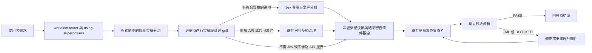

# 架構審查功能實作藍圖

狀態：草稿 v0.1；依本機路由與 CLI 整合更新階段進度。  
目的：將已定義的審查流程與條件轉成最小整合方案。本機 capability 入口、工作流路由 overlay 與 Jev CLI 已存在；CI 閘門維持未啟用。第一階段的實際程式變更試行仍待進行。

## 1. 現有環境盤點

已檢查的全域工作區中，大部分路由與專業審查元件已存在：

| 現有元件 | 目前職責與整合影響 |
|---|---|
| agents/workflow-router.toml | 最上層的建議路由器，負責路由、驗證層級，以及另一個用途的 Jev 路由預檢。架構審查以 `required_skill_overlays` 疊加，不取代程式執行者。 |
| skills/using-superpowers/agent-routing-rules.yaml | 正式路由規則。API 契約審查已路由至 api-contract-governance；API 實作也會掛上該技能。保留這些 API 專屬路由。 |
| agents/api-contract-guardian.toml | 已有跨應用程式契約與架構符合度專家。只有受影響邊界需要時才使用，不另建同職責審查者。 |
| skills/api-contract-governance/SKILL.md | 既有契約流程，依宣告規則與程式證據回報 PASS／FAIL／UNKNOWN，並禁止將原始碼上傳到遠端 MCP。 |
| .local-trials/jev-api/jev_client.py 與 jev_architecture_scorer.py | 無額外依賴的 client 繼續負責 HTTP 傳輸；評分器提供 stdin/stdout CLI，工作流會在符合選項與資料政策條件時呼叫，並檢查回應完整性與分數計算。 |
| .local-trials/jev-api/jev_router.py | 選擇性全域路由預檢。應與架構選項評分器分開，不可把路由信心當成方案符合度。 |
| .local-trials/jev-api/tests | 保留 client／router 測試，並新增 `test_jev_architecture_scorer.py`，以 stub 與 mock HTTP 邊界驗證正規化 score 契約。 |
| capabilities/architecture-review | 本機 `SKILL.md` 入口與審查文件已存在；由全域路由 YAML 以 overlay 名稱直接載入，未新增 registry dispatch 模式。 |
| capabilities/registry.json 與 capabilities/sync-policy.json | Capability 註冊與同步分類採明確管理。目前沒有 architecture-review 項目；依現行政策，公司或未知情境的同步需人工核准。 |

實際含意是：程式碼變更會自動套用輕量架構／重用分流；符合資格且允許外部評估時，Jev CLI 會由工作流自動呼叫。任務記錄、CI 閘門與真實專案試行尚未完成。

## 2. 建議的系統架構

架構審查應是**橫向治理閘門**，不取代原本選定的實作負責者。

### 職責分工

- **workflow-router／using-superpowers：** 判斷是否需要輕量架構分流並選擇既有語意執行者；保留路由權責和驗證層級政策。
- **architecture-review 入口：** 套用審查格式、檢查本機證據、評估影響／深度、整理 grill 選項、建立凍結的決策與審查條件基線，並準備實作後的審查紀錄。
- **architect-deep：** 支援跨模組設計或尚未解決的重大架構選擇；不負責執行正式程式碼，也不負責最後驗收。
- **既有實作負責者：** 實作選定設計，沿用現有程式變更、前端或領域專家負責者。
- **api-contract-governance／api-contract-guardian：** 影響公開／共用 API、事件、schema 或提供端／消費端邊界時才加入。程式實作流程仍是主要路徑。
- **Jev 方案評分器：** 在有證據的選項成立後，執行一次型別化輔助評估；它不是 agent，也不核准設計。
- **acceptance_process：** 實作後套用凍結的結果審查條件。既有驗證契約要求獨立審查時，使用獨立審查者。

v1 不新增常駐的架構審查 worker。用一個 capability skill 加上 router 疊加規則，避免增加重複職責的 agent。

## 3. 路由與觸發整合

### 入口政策

1. 對既有專案中實質的原始碼建構／新增／修改／刪除／重構，實作前自動做輕量分流；分流結果可以是不需正式 grill。
2. 問答、純文件工作，或不影響行為／契約的機械式修改，除非使用者要求架構審查，否則跳過程式變更分流。
3. 依程式庫證據判斷操作類型與受影響邊界，不可只靠需求句子的動詞判斷。
4. 保留既有語意執行路由。架構審查增加工作流節點／疊加層，不接管程式碼責任。
5. 只有重大架構設計才升級給 architect-deep。只有相關契約邊界受影響時，才加入 API 契約治理。
6. 程式庫探索後才計算影響分數；最上層路由器不可只看需求文字就捏造分數。

### 路由輸出擴充

初始路由只輸出「是否需要分流」與下一工作流節點。探索完成後，架構審查紀錄再保存：

- 操作類型：建構／修改／新增／刪除
- 架構分數與各面向證據
- 審查深度：不需正式 grill／聚焦 grill／完整 grill
- 強制升級條件與原因
- 重用搜尋涵蓋範圍與候選判斷
- 目前節點與閘門狀態

建議節點名稱：architecture_triage、architecture_grill、criteria_baseline、implementation、result_review、closed。細節流程由 capability skill 擁有；最上層 router 引用該 skill，不複製評分規準。

### 與既有路由規則對齊

- 保留 api_contract_change 作為 API 實作的前／後置契約審查疊加層。
- 保留 api_contract_review 處理 API／邊界符合度調查。確保一般架構審查不會在缺少 API／邊界訊號時誤走 API 專屬路徑。
- 一般程式變更、API 契約變更、bugfix、執行程式實作計畫與程式碼 diff 審查，透過 `required_skill_overlays: [architecture-review]` 自動載入；不改變各路由原有主要負責者。

## 4. 審查紀錄與交接契約

v1 不需要外部資料庫。將目前審查紀錄保留在當前任務／工作產物中；預設不把生成的審查檔寫進專案 repo。只有決策會長期影響專案架構，且 repo 有 ADR 慣例時，才保存正式 ADR。

紀錄欄位：

- 審查 ID 與紀錄版本
- 預期成果、範圍、不包含事項、限制與操作類型
- 受影響模組、架構證據參照、可重用候選、已檢查呼叫點與測試
- 影響分數、審查深度、強制升級條件與 grill 決策
- Jev 狀態與已驗證的選項評分（若符合資格）
- 選定設計、責任歸屬、允許的依賴變更、契約／生命週期決策
- 審查條件基線版本與狀態：READY_FOR_IMPLEMENTATION／NEEDS_CLARIFICATION／BLOCKED
- 變更版本／diff 參照
- 每項條件結果：PASS／FAIL／NOT_RUN／BLOCKED／EXEMPTED、證據與發現事項
- 最終結果：PASS／FAIL／BLOCKED、已接受風險、負責人與剩餘假設

### 交接內容

| 交接 | 必要資料 |
|---|---|
| 分流 → 架構設計 | 使用者成果、操作類型、受影響區域、證據涵蓋、分數／深度與觸發原因。 |
| 架構設計 → 實作負責者 | 選定方案、界定好的範圍、模組負責者、契約／依賴／生命週期決策、凍結的本次審查條件、必要證據與非阻擋假設。 |
| 架構設計 → Jev | 只傳送清理後的 architecture-option-score.v1 請求、精簡摘要與不透明證據 ID；不可傳原始碼、原始 diff、密鑰、客戶資料或完整對話。 |
| 架構設計／實作 → API 契約審查者 | 清理後的契約描述、提供端／呼叫端參照、已宣告架構規則與特定語意／相容性問題。 |
| 實作負責者 → 驗收流程 | 精確的變更版本／diff、決策與審查條件基線版本、測試／檢查結果及已知缺口。 |
| 驗收流程 → 使用者 | PASS／FAIL／BLOCKED、條件 ID、證據、發現事項、必要修正與剩餘風險。 |

## 5. Jev 評分器的實作邊界

既有通用 JevClient 負責 HTTP 傳輸。本機評分器位於 `.local-trials/jev-api/jev_architecture_scorer.py`，由架構審查入口透過 stdin/stdout CLI 呼叫，並會：

- 試行期間放在現有 client 旁邊，以獨立模組／函式處理，不混入 jev_router.py。
- 僅接受正規化的 architecture-option-score.v1 請求。
- 網路呼叫前先拒絕不符合資格或被政策阻擋的請求。
- 傳送前清理內容；將所有候選選項放在同一批次；把答案 ID 映射回選項 ID。
- 驗證答案型別、選項完整性、分數／信心範圍、機率鍵與總和，以及評分規準。
- 將設定、供應商與網路錯誤正規化為既定狀態；Jev 失敗時，不阻擋整體人工架構審查。
- 只輸出已驗證數值與最少操作資訊；不可記錄憑證或原始上下文。
- 使用現有 JEV 環境設定；除非有實際必要，否則不新增 HTTP client 或依賴。

Router 的選擇性 Jev 路由預檢仍是獨立呼叫，目的與 schema 都不同。不可把它的 choice／noul 答案併入架構 score 答案。

## 6. 推進階段

| 階段 | 產出 | 進入下一階段的條件 |
|---|---|---|
| 0. 規格 | 現有審查格式、評分介面、工作流、結果條件與本實作藍圖。 | 使用者確認設計方向與仍待決的政策選擇。 |
| 1. 本機 capability | 精簡的 `capabilities/architecture-review/SKILL.md` 入口、Goldfish 觸發／角色矩陣與參考文件已建立；全域路由會套用於 code changes、code reviews 及符合條件的長期軟體設計提案。Fresh-context reviewer 的端到端試行仍待完成；未加入 CI。 | 審查紀錄容易理解；角色映射能覆蓋觸發維度；決策／條件交接無缺口；誤觸 grill 的情況可接受。 |
| 2. 本機 Jev 評分器 | 已實作於 `.local-trials/jev-api/jev_architecture_scorer.py`；mock 測試涵蓋有效分數、選項缺漏／多餘、機率錯誤、API 失敗、資料政策拒絕與既有 HTTP client 邊界。 | **本機驗證已通過：** 正規化結果符合介面；無效／不可用回應不產生分數。 |
| 3. Router／capability 註冊 | 已更新全域路由規則與 router prompt：一般程式變更、API 變更、bugfix、程式實作計畫、code diff 審查，以及會決定長期邊界的軟體設計提案會自動掛上架構審查 overlay。Goldfish 僅依既有 grill 門檻及角色矩陣啟動；保留原有主要執行者與 API／安全／合規領域審查，不擴充 registry dispatch schema。 | 路由政策與真實試行確認不需 grill、聚焦／完整 grill、角色映射、領域邊界及非程式任務的觸發合理。 |
| 4. 試行 | 選一個範圍明確的 repo 試用；記錄誤判、漏判、漏掉的重用候選、時間／成本和結果審查歧異。 | 依證據調整門檻與提問；仍不自動阻擋 merge。 |
| 5. 選擇性導入 CI | 只加入專案原生、可確定的檢查：既有測試、API schema／相容性、架構規則，以及有用的重複碼工具。語意重複判斷仍須可由人檢查。 | 專案明確採用檢查，並定義哪些失敗會阻擋 merge。 |

不要從中央資料庫或通用 CI 閘門開始。第一輪試行使用任務產物與專案既有檢查即可。

## 7. 實作後的驗證計畫

完成整合時應驗證：

- Goldfish 路由：0–2 且無覆寫條件不執行；3–5 聚焦；6–10／完整覆寫條件完整審查；明確獨立設計審查至少聚焦；validation tier 單獨不觸發。
- 角色映射：每次 Goldfish 審查固定啟動 `Zoom Out`、`Comprehension`、`Design Critic`；依非零面向與文件條件選擇 `Codebase Details`、`Implementation Readiness` 等條件角色。綠地專案不啟動需依據程式庫的 `Codebase Details`；格式／文字角色依條件啟動；API、安全與合規閘門保持有效。
- 隔離與責任：reviewer 不取得先前對話且為唯讀；使用者不允許子代理或 runtime 無法隔離時回報 `NOT_RUN`；不改變原實作負責者與 acceptance owner。
- 路由案例：單一模組小變更、高影響邊界變更、API 契約變更、純文件需求與不需 grill 的結果。
- 審查條件閘門：就緒、需要釐清、缺少證據，以及試圖事後降低條件。
- 重用判斷：同語意必須重用；相似形式但生命週期不同可分開；無理由複製應失敗。
- Jev 評分器使用 mock HTTP 邊界的單元測試；測試不需要真實 API key。
- 結果審查案例：必要條件全通過、重大條件失敗、必要檢查未執行、明確豁免、設計邊界改變而需重分流。
- 依既有腳本與慣例驗證 registry／sync 與路由 schema。

整合成功不表示每項任務都要完整 grill，而是每項適用的程式變更都先完成適當分流，只有重大未決決策才暫停實作。

## 8. 實作時要保留的決策

- 架構審查是疊加閘門；既有語意執行者保留程式碼責任。
- 使用者決定重大業務／架構取捨；Jev 只供參考。
- 審查條件在實作前凍結，實作後依原條件判斷。
- capability 在 registry 分類與同步政策明確前保持本機。
- API 契約審查只在真實邊界受影響時執行，不套用到所有程式變更。
- CI 強制執行需等試行與專案採用；語意重複碼不能化約成相似度分數。

## 9. 實作狀態

本文件仍是實作計畫，不代表已啟用 CI 強制機制。全域 agent 路由目前會自動載入 architecture-review overlay；Goldfish 觸發門檻、角色映射、fresh-context 與 NOT_RUN 規則已寫入全域流程，條件符合時依 runtime 執行。Jev 條件符合且資料政策允許時會透過 CLI 呼叫。Goldfish 端到端 runtime 試行、決策紀錄持久化及 CI 閘門尚未完成。
