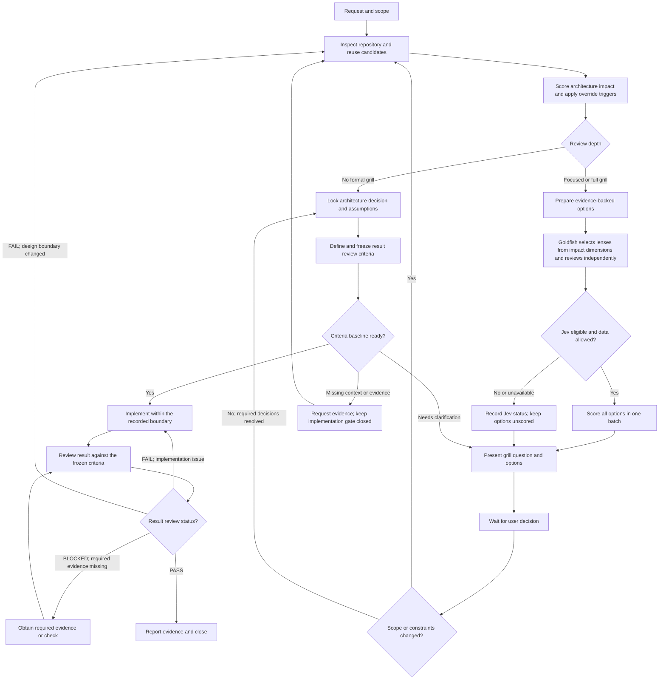

# Architecture Review Workflow

Status: Draft v0.1  
Scope: End-to-end review orchestration. Global agent routing applies this workflow to substantive repository code changes, code-diff reviews, and qualifying long-lived software design proposals. Goldfish fresh-context reviews run through the global agent runtime; if isolation cannot be guaranteed, report them as not run. The local Jev scoring CLI is implemented separately and is called only when eligible and permitted by data policy. This workflow is not a CI or GitHub PR enforcement gate.

## 1. Purpose and boundaries

Use this workflow to decide whether a code change or long-lived software design proposal can proceed within established architecture or needs a focused/full architecture grill first. When a formal grill triggers, Goldfish reviewers independently inspect the design before implementation to catch unclear ownership, unnecessary duplicate implementations, contract drift, unsafe dependency changes, and unplanned lifecycle impact.

The workflow complements:

- [Architecture Review Format](architecture-review-format.md) for impact scoring, grill triggers, question content, and review records.
- [Jev Option Scoring Interface](jev-option-scoring-interface.md) for the Jev request, response, scoring rubric, and validation.
- [Architecture Change Result Review Criteria](architecture-result-review-criteria.md) for pre-implementation criteria baselines and post-implementation verdicts.
- [Architecture Review Implementation Blueprint](architecture-review-implementation-blueprint.md) for the proposed router, capability, Jev adapter, storage, and rollout integration.

A Jev score is advisory. It never selects an architecture or authorizes implementation by itself.

The governing order is: **confirm requirements → design and decide the architecture → define and freeze the change-specific result-review criteria → implement → review the result against those same criteria**. Repository discovery, impact triage, option scoring, and the grill are activities inside the architecture-design stage.

## 2. Roles and responsibilities

| Role | Responsibility |
|---|---|
| User / product owner | States the desired outcome and constraints; decides unresolved product and architecture tradeoffs. |
| Local review orchestrator | Inspects repository evidence, searches for reusable capabilities, scores impact, chooses review depth, prepares questions, records decisions, and checks implementation against the decision. |
| Goldfish reviewers | Use isolated fresh contexts and read-only tools to review the decision packet under their selected lenses; report evidence-backed findings without editing, implementing, or deciding for the user. |
| Jev scorer | Rates each eligible option against the supplied shared rubric. It does not inspect the repository, author the rationale, or approve a design. |
| API contract reviewer / agent | When a public or cross-module contract is affected, checks request/response semantics, compatibility, versioning, and provider/consumer impact. It does not replace the architecture review. |
| Project validation tools | Run the agreed behavior, contract, architecture, duplication, security, and failure-path checks. Report evidence and failures. |

## 3. Workflow at a glance

## 4. Stages and transitions

| Stage | Actions | Output and transition |
|---|---|---|
| 1. Requirements confirmation and intake | Record the intended outcome, observable user behavior, explicit non-goals, operation type (construct, modify, add, delete), project/area, constraints, and known consumers. | A bounded change request. If the target project or affected area is unknown, pause for that context. |
| 2. Repository discovery | Read declared architecture rules and contracts. Locate affected modules, providers/consumers, candidate functions/services, call sites, tests, data models, and dependency direction. Use symbol search/code graph and duplication tools where available. For greenfield work with no code, collect goals, constraints, proposed boundaries, and explicit unknowns instead of inventing repository evidence. | An evidence map and reuse candidates. If evidence cannot establish an important fact, label it unknown. |
| 3. Impact assessment | Apply the 0–10 dimensions and operation-specific signals in the Architecture Review Format. Score using evidence and state the reason for each non-zero dimension. Apply override triggers independently of the total. | A review depth: no formal grill, focused grill, or full architecture grill. |
| 4. Route decision | Use no formal grill only when the change stays inside an established owner/boundary, material decisions are resolved or safely reversible, and no override applies. Use focused grill for the 3–5 band or any focused override. Use full grill for the 6–10 band or when ownership, compatibility, migration, rollback, or cross-system responsibility is unresolved. | No-grill path proceeds to a recorded implementation boundary. Grill path prepares a decision packet. |
| 5. Decision packet | For each material unresolved decision, state the repository evidence, affected owner/contract/dependency/lifecycle, and 2–3 viable mutually exclusive options. Include expected behavior, impact, main tradeoff, and an Other path. Remove options known to violate confirmed hard constraints; keep unresolved checks visible as unknowns. | A concise question set. Ask only decisions that repository evidence cannot settle and that could change the design. |
| 6. Goldfish review | Select reviewers by scored dimensions and override signals. Each reviewer receives the same minimal decision packet, its role rubric, and only the necessary referenced sources; review independently in a fresh context with read-only tools. | Deduplicated findings, disagreements, and unknowns. Goldfish does not approve a design. If subagents are prohibited or isolation is unavailable, record `NOT_RUN`; do not present same-thread self-review as Goldfish. |
| 7. Jev evaluation | After Goldfish findings have been incorporated into the options, call the scorer only when there are 2–3 comparable viable options, a sanitized request, and external evaluation is allowed. Send one batch with the same rubric. | Add fit score, confidence, and distribution per option, or show ineligible, blocked_by_policy, unavailable, or invalid_response. Never invent or reuse routing confidence. |
| 8. User decision gate | Present one decision at a time, or group tightly coupled decisions. Show local evidence, options, tradeoffs, Goldfish findings, Jev signal/status, and remaining uncertainty. Mark an option Recommended only when local evidence supports it; reviewer or Jev results alone cannot choose it. | Pause for the user where the decision changes ownership, contract semantics, permitted dependencies, compatibility/lifecycle, risk acceptance, or another material tradeoff. Do not begin architecture-dependent implementation while such a decision remains unresolved. |
| 9. Decision baseline | Record the selected option, rejected alternatives when useful, rationale/evidence, constraints, allowed dependency changes, contract/lifecycle plan, and accepted assumptions. | A versioned-in-review architecture decision record. If the user's answer changes outcome, scope, or constraints, invalidate affected options/scores and return to discovery and triage. |
| 10. Result-review criteria gate | Instantiate the criteria in [Architecture Change Result Review Criteria](architecture-result-review-criteria.md) for this specific change. For every applicable criterion, define a stable ID, source requirement/decision, observable pass/fail condition, evidence or check, and reviewer/owner. Mark exemptions with a reason. Show the conditions before coding; resolve any criterion that changes user-visible behavior, a quality threshold, or risk acceptance. | Set the baseline status to READY_FOR_IMPLEMENTATION only when in-scope conditions are observable, required evidence/checks are identified, and no unresolved ambiguity can change implementation or verification. Otherwise return to grill or request clarification. Freeze/version the baseline before implementation. Do not weaken or retrofit criteria after seeing the result. |
| 11. Implementation | Implement only the recorded scope and ownership. Reuse an existing capability when business semantics, errors, side effects, and lifecycle match. If no matching implementation exists, document the difference that justifies new code. | A change set traceable to the decision and review-criteria baselines. If implementation requires crossing a new boundary, return to discovery and triage before proceeding across it. |
| 12. Result review | Apply the frozen, change-specific criteria and the pass/fail evidence rules in [Architecture Change Result Review Criteria](architecture-result-review-criteria.md). | Record PASS, FAIL, or BLOCKED with criterion IDs and evidence. A changed design returns to triage; an implementation failure returns to correction and re-review. |
| 13. Close | Report outcome, review depth, score, Goldfish status and selected roles, architecture conformance (pass/fail/unknown), reuse decision, user decisions, result-review status, validation evidence, and residual risks/assumptions. | Close only after an overall PASS. Keep FAIL/BLOCKED explicitly open with the required correction, evidence, or owner. |

## 5. Grill and Jev policies

### Goldfish reviewer execution

Run Goldfish only for an existing focused/full grill or an explicit request for independent design review. A `multi_stage` or `high_risk` validation tier alone does not trigger Goldfish. An explicit independent-review request triggers at least focused review; run full depth only when requested or required by impact conditions. Use the role matrix in [Architecture Review Format](architecture-review-format.md): every review includes `Zoom Out`, `Comprehension`, and `Design Critic`; focused reviews add only matched conditional lenses. Full reviews follow the ordered Goldfish stages; run the intermediate `Zoom Out` only after selected reviewer feedback has been applied to revise the packet, then run conditional `Implementation Readiness` and `Codebase Details`. For that second pass, reviewers receive the revised packet and change summary in a fresh context. `Implementation Readiness` and `Codebase Details` remain conditional on their matrix triggers; otherwise record `NOT_APPLICABLE`. For greenfield work, `Zoom Out` / `Design Critic` assess proposed boundaries while repository facts remain `UNKNOWN`; `Codebase Details` applies only when code evidence exists. `Structural Validator` / `Style Editor` run only when the artifact requires them.

Reviewers use isolated fresh contexts and read-only tools, receiving the same minimal decision packet and listed sources. The intermediate `Zoom Out` receives the revised packet and the change summary after selected feedback is applied. Findings cite evidence, impact, and open questions; unsupported claims are `UNKNOWN`. The `Synthesizer` only deduplicates and preserves disagreement. If the user prohibits subagents or the runtime cannot establish context isolation, record `NOT_RUN`, retain applicable safety/domain/user-decision gates, and do not claim a Goldfish pass.

### When to pause for the user

Pause when repository evidence cannot answer a material choice, especially:

- Module ownership or service boundary is unclear.
- A public/shared contract, data model, or dependency direction must change.
- Compatibility, migration, deprecation, rollback, or dual support needs a product decision.
- Multiple viable options have materially different risk, cost, or behavior.
- Confirmed constraints conflict or no viable option remains.

Do not pause merely to ask for facts available by repository inspection. Ask for missing project/context when inspection cannot begin.

### When Jev is called

Jev runs after local discovery and option preparation, and before options are presented. It is skipped when there is fewer than two comparable options, the request is not sufficiently grounded/sanitized, or policy blocks external evaluation. An unavailable or invalid Jev result does not block the user from seeing evidence-backed options; show the status and omit score values.

No confidence threshold is a gate in v0.1. Show the returned confidence and probability distribution as-is. If Jev is uncertain or disagrees with local evidence, expose that disagreement and keep the human decision gate.

### Contract reviewer handoff

When an API, event, shared schema, or provider/consumer boundary changes, send the sanitized contract description and affected consumer/provider evidence to the API contract reviewer. Bring its compatibility and semantic findings into the decision packet and validation checklist. Resolve contradictions with repository evidence and the user; do not treat an agent result as an approval.

## 6. Review record

Each review record contains:

- Review ID, request, outcome, explicit non-goals, operation type, and affected area.
- Architecture score, per-dimension evidence, override trigger, and chosen review depth.
- Architecture rules/contracts inspected; affected modules, consumers, providers, dependencies, and reusable candidates.
- Reuse decision, including the semantic/lifecycle reason for new implementation when applicable.
- Grill questions, options, evidence, Jev status/results, user selections, and unresolved unknowns.
- Locked scope/ownership/contract/dependency/lifecycle decisions and accepted assumptions.
- The frozen, change-specific review-criteria baseline, its version, applicability/exemptions, and final results.
- Required validations, their pass/fail/not-run status and evidence, plus residual risks.

## 7. Workflow failure handling

| Condition | Handling |
|---|---|
| Repository/project context is missing | Ask for the smallest missing context needed to inspect; do not fabricate evidence or score yet. |
| No matching reusable capability is found | Record search scope and candidates checked. Treat absence as a search finding, not proof that no similar behavior exists elsewhere. |
| A known hard-constraint violation is found | Exclude that option as non-viable and explain the conflict. If all options are excluded, pause and ask how to resolve the conflict. |
| Result-review criteria are vague or lack evidence/check definitions | Do not begin implementation. Clarify the condition, evidence, and owner, then freeze the criteria baseline. |
| A criterion is changed after implementation starts | Record why and who approved the change. If it changes scope, observable behavior, risk acceptance, or architecture, reopen the relevant decision gate; never silently weaken a failed criterion. |
| Jev is ineligible, blocked, unavailable, or invalid | Preserve the status, show no Jev score, and continue with local evidence if the decision packet is otherwise sound. |
| API contract reviewer is unavailable | Record that the specialized check was not run; use repository contracts and consumer/provider analysis, and do not claim a contract pass. |
| User response changes the design materially | Invalidate affected scores/options and repeat discovery, impact scoring, and any required grill. |
| A validation check fails | Route implementation-only failures to correction; route architecture/contract drift back to discovery and the decision gate. |

## 8. Workflow completion criteria

The review workflow is ready to close when:

- The change has a bounded outcome and scope.
- Review depth is supported by the impact score and override checks.
- Reuse was investigated and the decision is evidence-backed.
- Required architecture decisions are recorded before dependent implementation.
- Change-specific review criteria were made observable and frozen before implementation.
- Jev scores, when present, are validated and presented as advisory signals.
- Contract review was included when a relevant boundary changed, or its omission is recorded.
- Required checks have results or an explicit not-run disposition; the overall result-review status is PASS before closure.
- Residual unknowns and risks are visible.

## 9. Implementation status

Global `using-superpowers` routing loads this workflow for substantive code changes, code-diff reviews, and qualifying long-lived software design proposals. It performs lightweight impact/reuse triage first and runs fresh-context Goldfish reviewers only when focused/full grill criteria or an explicit independent-review request apply. Reviewer lenses come from the role matrix. When a grill has two or three viable options, the summary is sanitized, and project data policy explicitly allows external evaluation, the workflow invokes the local Jev scorer CLI automatically. Otherwise it records the applicable status and continues without scores. This is agent-workflow integration, not GitHub PR/CI enforcement; Goldfish execution evidence and review records remain in the current task rather than being persisted to the project or a central database. A live end-to-end Goldfish runtime trial remains outstanding.
