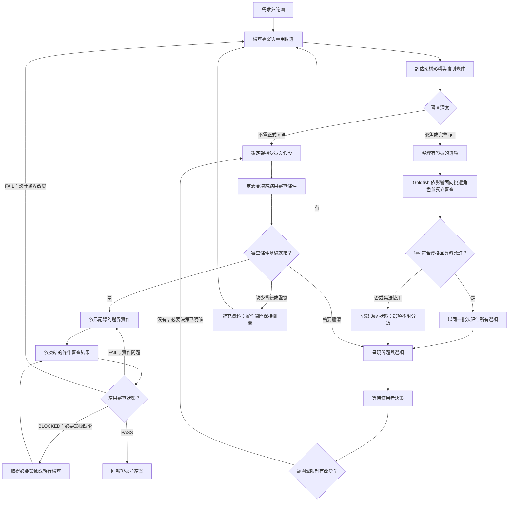

# 架構審查工作流

狀態：草稿 v0.1  
範圍：定義端到端審查流程；本文件描述人與 agent 如何協作，不代表 CI 閘門已啟用。本機 Jev 評分 CLI 已另行實作，僅在符合資格且資料政策允許時由流程呼叫。Goldfish fresh-context 審查依全域 agent 能力執行；若執行環境無法保證隔離，必須回報未執行。

## 1. 目的與邊界

這套流程用來判斷程式變更或長期軟體設計提案能否沿用既有架構，或必須先做聚焦式／完整架構 grill。觸發正式 grill 時，Goldfish reviewer 以新脈絡檢查設計成果，在實作債務累積前發現責任歸屬不明、不必要的重複實作、契約漂移、不安全的依賴變更，以及未規劃的生命週期影響。

本流程搭配下列文件：

- [架構審查格式](architecture-review-format.zh-TW.md)：定義影響評分、grill 觸發條件、問題內容與審查紀錄。
- [Jev 架構選項評分介面](jev-option-scoring-interface.zh-TW.md)：定義 Jev 請求、回應、評分規準與驗證方式。
- [架構變更結果審查條件](architecture-result-review-criteria.zh-TW.md)：定義實作前的條件基線與實作後的審查結論。
- [架構審查功能實作藍圖](architecture-review-implementation-blueprint.zh-TW.md)：定義預計如何整合 router、capability、Jev adapter、紀錄保存與分階段導入。

Jev 分數只供參考，不會自行選定架構，也不會單獨授權開始實作。

整體順序是：**確認需求 → 設計並決定架構 → 定義並凍結本次變更的結果審查條件 → 執行實作 → 依同一組條件審查結果**。程式庫探索、影響分流、方案評分與 grill 都屬於架構設計階段的活動。

## 2. 角色與責任

| 角色 | 責任 |
|---|---|
| 使用者／產品負責人 | 說明預期成果與限制；決定尚未解決的產品取捨與架構取捨。 |
| 本機審查協調者 | 檢查專案證據、搜尋可重用能力、評估影響、決定審查深度、準備提問、記錄決策，並確認實作符合決策。 |
| Goldfish reviewers | 依[角色矩陣](architecture-review-format.zh-TW.md)使用獨立 fresh context 與唯讀工具檢查決策資料；只回報有證據的發現，不編輯文件、實作或替使用者決策。 |
| Jev 評分器 | 依提供的共同規準評估符合資格的選項；不檢查程式庫、不撰寫證據理由，也不核准設計。 |
| API 契約審查者／agent | 影響公開或跨模組契約時，檢查請求／回應語意、相容性、版本與提供端／消費端影響；不能取代架構審查。 |
| 專案驗證工具 | 執行約定的行為、契約、架構、重複碼、安全與故障路徑檢查，並回報證據與失敗。 |

## 3. 流程一覽

## 4. 階段與轉換

| 階段 | 行動 | 產出與下一步 |
|---|---|---|
| 1. 需求確認與接收 | 記錄預期成果、可觀察的使用者行為、明確不包含的範圍、操作類型（建構／修改／新增／刪除）、專案／影響區域、限制與已知呼叫端。 | 範圍明確的變更需求。若不知道目標專案或影響區域，先詢問必要背景。 |
| 2. 專案探索 | 閱讀已宣告的架構規則與契約。找出受影響模組、提供端／消費端、候選函式／服務、呼叫點、測試、資料模型與依賴方向。可用時使用符號搜尋／程式碼關係圖與重複碼工具。綠地專案沒有程式碼時，改整理目標、限制、預計邊界與明確未知；不可捏造程式庫證據。 | 證據圖與可重用候選。重要事實若無法由證據確認，標示為未知。 |
| 3. 影響評估 | 依《架構審查格式》的 0–10 面向與操作訊號評分。以證據評分，並說明各非零面向的原因。強制升級條件獨立於總分判斷。 | 審查深度：不需正式 grill、聚焦式 grill 或完整架構 grill。 |
| 4. 路由決策 | 只有在變更留於明確的責任模組／邊界內、重大決策已解決或可安全回復，且沒有強制條件時，才走不需正式 grill。3–5 分或符合聚焦升級條件時採聚焦 grill。6–10 分，或責任、相容性、遷移、回復、跨系統責任未明時採完整 grill。 | 不需 grill：記錄實作邊界後繼續。需要 grill：準備決策資料包。 |
| 5. 決策資料包 | 每項重大未決決策列出專案證據、受影響責任／契約／依賴／生命週期，以及 2–3 個可行、互斥的選項。說明預期行為、影響、主要取捨，並提供「其他」選項。已知違反硬性限制的方案應排除；尚未確認的檢查則列為未知。 | 精簡問題集。只詢問原始碼或專案證據無法回答、且可能改變設計的事項。 |
| 6. Goldfish 獨立審查 | 依分數面向與覆寫條件選擇 reviewer；每位 reviewer 只收到相同的最小決策資料包、其角色規準及必要來源。每位 reviewer 用 fresh context 和唯讀工具獨立回報。 | 彙整去重後的發現、分歧與未知；Goldfish 不核准方案。若使用者禁止子代理或無法保證隔離，記錄 `NOT_RUN`，不可用同一對話自我檢查冒充。 |
| 7. Jev 評估 | 在 Goldfish 發現已納入選項後，只有仍有 2–3 個可比較的可行選項、請求已清理且允許外部評估時才呼叫。所有選項使用同一批次與同一規準。 | 每個選項附符合度、信心與分布，或標示 ineligible、blocked_by_policy、unavailable、invalid_response。不可捏造分數或挪用路由信心。 |
| 8. 使用者決策閘門 | 一次呈現一項決策，只有緊密相關時才合併。顯示本機證據、選項、取捨、Goldfish 發現、Jev 訊號／狀態與剩餘未知事項。只有本機證據支持時才標註「建議」；不可只靠 reviewer 或 Jev 結果選方案。 | 若決策會改變責任、契約語意、允許的依賴、相容性／生命週期、風險承擔或其他重大取捨，暫停並等待使用者決定。相關決策未解前，不開始依賴該決策的實作。 |
| 9. 鎖定決策基準 | 記錄選定方案、必要時記錄未選方案、理由／證據、限制、允許的依賴變更、契約／生命週期方案與已接受假設。 | 在審查紀錄中建立版本化的架構決策。若使用者回覆改變成果、範圍或限制，作廢受影響的選項與分數，重新探索與分流。 |
| 10. 結果審查條件閘門 | 依[架構變更結果審查條件](architecture-result-review-criteria.zh-TW.md)，為本次變更具體化審查條件。每個適用條件都要有穩定 ID、來源需求／決策、可觀察的通過／失敗條件、證據或檢查方式，以及審查者／負責人。不適用項目須附豁免理由。施作前呈現條件；若條件會改變使用者可見行為、品質門檻或風險承擔，須先釐清。 | 只有在範圍內條件可觀察、必要證據／檢查已確定，且沒有會改變實作或驗證範圍的未解歧義時，才能將基線標為 READY_FOR_IMPLEMENTATION。否則回到 grill 或補充需求。施作前凍結／標記版本；不可看完結果後才降低或補訂條件。 |
| 11. 實作 | 僅實作已記錄的範圍與責任。若既有能力的業務語意、錯誤、副作用和生命週期相符，應予以重用。若沒有相符實作，記錄足以支持新增程式碼的差異。 | 變更集須可追溯至架構決策與審查條件基線。若實作需要跨越新邊界，先回到探索與分流，再跨越邊界。 |
| 12. 結果審查 | 套用已凍結、針對本次變更的條件，以及[架構變更結果審查條件](architecture-result-review-criteria.zh-TW.md)定義的通過／失敗證據規則。 | 依條件 ID 與證據記錄 PASS、FAIL 或 BLOCKED。設計改變時回到分流；實作未通過時修正後重新審查。 |
| 13. 結案 | 回報成果、審查深度、分數、Goldfish 是否執行與 reviewer 角色、架構符合度（通過／不通過／未知）、重用判斷、使用者決策、結果審查狀態、驗證證據與剩餘風險／假設。 | 整體結果審查為 PASS 後才能結案。FAIL／BLOCKED 必須保持明確開啟，並列出修正、證據或負責人。 |

## 5. Grill 與 Jev 政策

### Goldfish reviewer 執行

只在既有分流結果為聚焦／完整 grill 時執行 Goldfish；不以 `multi_stage` 或 `high_risk` validation tier 單獨觸發。使用者明確要求獨立設計審查時至少執行聚焦 Goldfish；完整深度只在使用者明確要求或既有影響條件要求時採用。依[Goldfish 角色矩陣](architecture-review-format.zh-TW.md)選角：每次審查固定執行 `Zoom Out`、`Comprehension`、`Design Critic`，聚焦審查只加入命中的條件角色。完整審查依 Goldfish 有序階段執行；只有採納 reviewer 意見並修訂決策資料包後，才以 fresh context 執行中段 `Zoom Out`，再依條件執行 `Implementation Readiness` 與 `Codebase Details`。`Implementation Readiness` 與 `Codebase Details` 仍只依角色矩陣條件觸發，否則標記 `NOT_APPLICABLE`。綠地專案由 `Zoom Out`／`Design Critic` 檢查提案中的預計邊界；`Codebase Details` 只在有程式碼證據時適用，`Structural Validator`／`Style Editor` 僅依文件條件觸發。

Goldfish reviewer 必須在互相隔離的新脈絡中工作，只讀相同版本的最小資料包及角色所需來源；中段 `Zoom Out` 讀取修訂版資料包與變更摘要。回報要包含證據位置、影響與未解問題；無證據資訊標為 `UNKNOWN`。`Synthesizer` 只能去重並保留分歧，使用者仍決定設計。若子代理被明確禁止或 runtime 無法證明脈絡隔離，記錄 `NOT_RUN`，保留既有安全、領域與使用者決策閘門，不宣稱 Goldfish 通過。

### 何時暫停等待使用者

當程式庫證據無法回答重大選擇時暫停，尤其是：

- 模組責任或服務邊界不明。
- 必須改變公開／共用契約、資料模型或依賴方向。
- 相容性、遷移、淘汰、回復或雙軌支援需要產品決策。
- 多個可行方案的風險、成本或行為有實質差異。
- 已確認限制互相衝突，或沒有可行方案。

不要為了詢問可以從程式庫檢查到的事實而暫停。若缺少專案／上下文而無法開始檢查，則詢問必要資訊。

### 何時呼叫 Jev

先完成本機探索與選項整理，再於呈現選項之前呼叫 Jev。少於兩個可比較選項、資訊不足或未完成清理、資料政策禁止時，不呼叫。若 Jev 無法使用或回應無效，只呈現狀態，不附分數；只要決策資料包本身完整，仍可依本機證據向使用者提問。

v0.1 不設信心門檻。原樣呈現信心與機率分布。若 Jev 信心低或與本機證據不一致，明確呈現差異並保留人工決策閘門。

### 契約審查交接

若變更影響 API、事件、共用 schema 或提供端／消費端邊界，將清理後的契約描述及受影響呼叫端／提供端證據交給 API 契約審查者。把相容性與語意發現納入決策資料包及驗證清單。若審查結論與程式庫證據矛盾，應呈現並釐清，不可把 agent 結果當成核准。

## 6. 審查紀錄

每筆審查紀錄包含：

- 審查 ID、需求、成果、明確不包含範圍、操作類型與影響區域。
- 架構分數、各面向證據、強制升級條件與審查深度。
- 已檢查的架構規則／契約；受影響模組、呼叫端、提供端、依賴與可重用候選。
- 重用判斷；若新增實作，記錄語意／生命週期差異。
- Grill 問題、選項、證據、Jev 狀態／結果、使用者選擇與未解事項。
- 已鎖定的範圍／責任／契約／依賴／生命週期決策及已接受假設。
- 已凍結、針對本次變更的審查條件基線、版本、適用性／豁免及最終結果。
- 必要驗證、通過／失敗／未執行狀態與證據，以及剩餘風險。

## 7. 工作流失敗處理

| 狀況 | 處理方式 |
|---|---|
| 缺少專案／程式庫上下文 | 詢問開始檢查所需的最少資訊；不可捏造證據或先評分。 |
| 找不到相符的可重用能力 | 記錄搜尋範圍和檢查過的候選。搜尋結果不等於證明其他地方完全沒有相似行為。 |
| 發現已知硬性限制違規 | 將該方案排除為不可行並說明衝突。若所有方案都被排除，暫停並詢問如何處理衝突。 |
| 結果審查條件模糊或未定義證據／檢查方式 | 不開始實作。先釐清條件、證據和負責人，再凍結條件基線。 |
| 開始實作後修改審查條件 | 記錄修改原因與核准者。若改變範圍、可觀察行為、風險承擔或架構，重新開啟相關決策閘門；不可默默降低未通過的條件。 |
| Jev 不符合資格、受政策阻擋、無法使用或回應無效 | 保留狀態，不呈現 Jev 分數；決策資料包若完整，仍可依本機證據繼續。 |
| API 契約審查者無法使用 | 記錄專門檢查未執行；使用專案契約與呼叫端／提供端分析，不可宣稱契約檢查通過。 |
| 使用者回覆實質改變設計 | 使受影響選項／分數失效，重新探索、評估影響，並進行必要 grill。 |
| 驗證檢查失敗 | 只有實作問題時回到修正；若有架構／契約漂移，回到探索與決策閘門。 |

## 8. 工作流結案條件

符合以下條件時，審查流程才可結案：

- 變更成果與範圍明確。
- 審查深度有影響分數與強制條件檢查支持。
- 已檢查重用候選，且判斷附有證據。
- 依賴架構決策的實作開始前，必要決策已記錄。
- 本次變更的審查條件已具體化，並在實作前凍結。
- 若有 Jev 分數，已驗證並以參考訊號呈現。
- 影響相關邊界時已納入契約審查，或明確記錄未做的原因。
- 必要檢查已有結果，或明確標示未執行及其處置；整體結果審查為 PASS 才可結案。
- 剩餘未知事項與風險清楚可見。

## 9. 實作狀態

全域 `using-superpowers` 路由會對實質程式碼變更、code diff 審查，以及符合條件的長期軟體設計提案自動載入本流程。先做輕量影響／重用分流；只有達到聚焦／完整 grill 條件才啟動 Goldfish fresh-context reviewer，並依角色矩陣選角。若 grill 有 2–3 個可行選項、摘要已清理且專案資料政策明確允許外部評估，工作流會自動透過 CLI 呼叫本機 Jev 評分器；其他情況會記錄狀態並繼續，不要求使用者手動執行程式。這是 agent 工作流整合，尚不是 GitHub PR／CI 強制閘門；Goldfish 執行證據與審查紀錄仍留在目前任務，未自動寫入專案或中央資料庫。Goldfish 的端到端 runtime 試行尚待完成。
