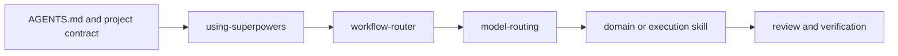

# Repository workflow

This repository carries its Codex workflow under `.codex/`. Use this file as the repo-local entry point; workflow execution must not depend on a maintainer's global profile or checkout path. See [README.md](README.md) for orientation and [project_contract.yml](project_contract.yml) for the package map and path policy.

## Workflow entry points

- [Architecture map](docs/codex-global-application-architecture.md) explains the layers and handoffs.
- Start task classification with [using-superpowers](.codex/skills/using-superpowers/SKILL.md) and its [routing rules](.codex/skills/using-superpowers/agent-routing-rules.yaml).
- [workflow-router](.codex/agents/workflow-router.toml) preserves routing decisions; [model-routing](.codex/skills/model-routing/SKILL.md) maps tasks to profiles under `.codex/skills/model-routing/references/agent-profiles/`.
- Domain and execution guidance lives under [.codex/skills/](.codex/skills/). Load the [architecture-review overlay](.codex/skills/architecture-review/SKILL.md) for qualifying code or architecture work.
- Completion follows [verification-before-completion](.codex/skills/verification-before-completion/SKILL.md); agent-run QA uses [supervisor-agent](.codex/skills/supervisor-agent/SKILL.md).
- Project-specific capability metadata is under [.codex/capabilities/](.codex/capabilities/). Optional integrations may be used when available; absent MCPs do not block repo-local discovery or work.

## Path rules

- Resolve repository content from the repository root or relative to the file that contains the reference.
- Keep host-global locations, usernames, drive letters, local caches, and binary locations out of workflow instructions.
- Treat connected tools and MCPs as optional; if unavailable, continue with repo search, source reads, and available checks.
- Keep credentials, session history, SQLite state, logs, attachments, and generated company artifacts outside Git.

Do not install or copy the package to a global profile as part of ordinary repo work. Use the repo-local `.codex/` content directly in this checkout.
