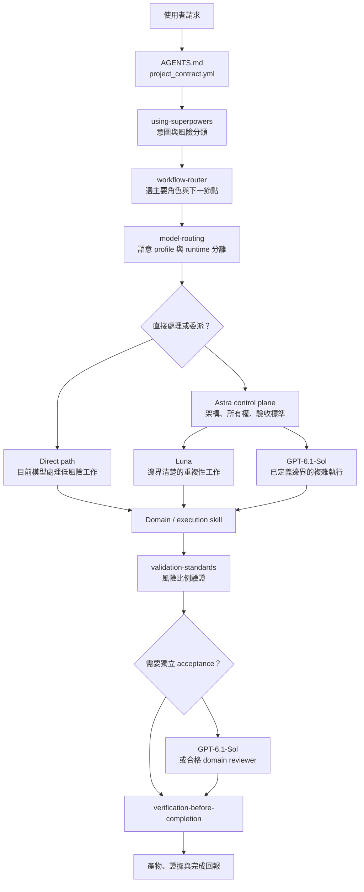

# MultiAgent.github.io

這個 repository 是一份可攜式的 Codex 全域工作流核心。它把可重用的路由規則、agent profile、skills、能力註冊表與驗證契約放在 `.codex/`，讓工作流可以從 GitHub 或任意 cloud checkout 直接讀取，不依賴某一台電腦的使用者名稱、磁碟機代號或全域設定。

這裡的「全域」指可跨專案重用的工作方法與控制規則，不是把主機上的 `config.toml`、認證、MCP 私密設定、session、cache 或日誌上傳到 repository。那些平台私有資料必須留在主機端。

## 這個全域在做什麼

它的工作不是替每個問題套用同一套重流程，而是把一個請求送進最小但足夠可靠的處理路徑：

1. 判斷請求的意圖、產物、風險、邊界與是否需要外部工具。
2. 選擇主要工作流、語意 agent profile、支援角色與下一個節點。
3. 決定由目前模型直接處理，或由 Astra 控制委派給合適的執行者。
4. 執行 domain skill 或 implementation skill，產出結果與可追溯證據。
5. 依風險套用 basic、standard、multi-stage 或 high-risk 驗證。
6. 在適用時進行獨立 acceptance，最後才回報完成、retry 或 rollback。

因此，這個全域解決的是「誰來做、用哪條路徑做、做到什麼程度才算完成，以及如何證明做對了」這四件事。

## 一張圖看完整流程



標準入口是 [AGENTS.md](AGENTS.md) 與 [project_contract.yml](project_contract.yml)；完整的層次、handoff 與 MCP 使用原則見 [Codex Global Application Architecture](docs/codex-global-application-architecture.md)。

## 各層負責什麼

| 層 | 位置 | 責任 |
| --- | --- | --- |
| Repository entry | [AGENTS.md](AGENTS.md) | 宣告本 repository 的入口、路徑規則、資料邊界與不可違反的工作原則。 |
| Project contract | [project_contract.yml](project_contract.yml) | 集中列出入口檔、工作流節點、資料夾政策、驗證命令與風險提醒。 |
| Intent classification | [.codex/skills/using-superpowers](.codex/skills/using-superpowers/) | 判斷任務形狀、風險、是否需要執行、主要與支援 skill，以及下一個 workflow node。 |
| Canonical routing policy | [agent-routing-rules.yaml](.codex/skills/using-superpowers/agent-routing-rules.yaml) | 定義 runtime model、effort、direct/delegated 條件、validation tier、evidence 與硬規則。 |
| Workflow control | [workflow-router.toml](.codex/agents/workflow-router.toml) | 保存路由控制面的角色與工作流入口；它負責維持分流決策，不是通用 production worker。 |
| Semantic routing | [model-routing](.codex/skills/model-routing/) | 把工作流映射到語意 profile；profile 定義責任與限制，不自行指定 runtime model 或 reasoning effort。 |
| Agent profiles | [.codex/skills/model-routing/references/agent-profiles](.codex/skills/model-routing/references/agent-profiles/) | 提供 `architect-deep`、`code-worker`、`debug-reviewer`、`doc-ops` 等可重用角色契約。 |
| Executable agent definitions | [.codex/agents](.codex/agents/) | 保存 Codex 可使用的 agent 定義與工作邊界；它們不是另一套獨立的路由真相。 |
| Domain and execution skills | [.codex/skills](.codex/skills/) | 提供實際的研究、寫作、程式、文件、資安、審查、驗證與領域工作方法。 |
| Capability registry | [.codex/capabilities](.codex/capabilities/) | 登錄能力的 domain signals、entry skills、router、文件與同步政策；能力不是把所有資料自動載入。 |
| Global relationship map | [.codex/global-agent-map](.codex/global-agent-map/) | 描述 agent、skill、capability 與路由拓撲的關係。 |
| Verification | [scripts/verify.ps1](scripts/verify.ps1) | 檢查必要目錄、路由資產、能力註冊、引用與禁止進 Git 的私有產物。 |
| Explanation and history | [docs/](docs/)、[records/](records/) | 保存架構說明、導入指南、調整紀錄與可追溯的歷史資料。 |

## 路由規則：不是每個請求都要委派

### 1. 先分類，再決定工作量

`using-superpowers` 先做意圖、產物與風險分類。它會優先尋找明確的 domain capability，再決定是否需要廣泛探索、agent、MCP 或更重的驗證。全域採用「能保護正確性的最小工作流」：簡單問題與文件編輯不應被不必要的多代理流程拖慢。

### 2. 低風險、邊界清楚的工作走 direct path

只有在以下條件全部成立時，才預設由目前模型直接處理：

- 請求與產物清楚。
- 風險低、範圍有界，且沒有重大跨邊界影響。
- 沒有明確要求委派或獨立 review。
- 沒有更強的 domain contract 要求專家或指定 runtime。

即使走 direct path，也要檢查相關輸入、驗證產物或行為，並把證據連回目前的答案或檔案。

### 3. 需要委派時由 Astra 控制

下列任一情況成立，就會進入 `sol-luna-orchestration` 相容路徑，由 Astra 建立控制包：

- 使用者明確要求委派、指定模型或要求獨立 review。
- 工作屬於高風險、高後果或安全／合規範圍。
- 有重大跨模組、跨服務、資料或 ownership 邊界。
- 需求、責任歸屬或驗收方式仍有實質歧義。
- 更強的 domain contract 要求專門角色或獨立驗收。

Astra 的責任是 `frame → select executor → define standards`：先界定架構、所有權、執行者與可觀察的 acceptance standards。Astra 不實作委派工作，也不代替 acceptance process 判定 pass/fail。

### 4. Luna、Sol 與 acceptance 的分工

| 角色 | 何時使用 | 不負責什麼 |
| --- | --- | --- |
| 目前模型 | 清楚、低風險、範圍小的 direct work | 不繞過適用的驗證與 domain gate。 |
| Astra | 委派前的架構、所有權、執行者與驗收標準 | 不執行 delegated packet，不解讀執行證據作 final acceptance。 |
| Luna | scope/output 清楚、歧義低、可重複或批次型，且總量確實值得 dispatch | 不是所有工作的通用 runtime；不能自我 acceptance。 |
| GPT-6.1-Sol 執行 | 已解決架構與驗收標準的 bounded complex coding 或 agentic workflow，且 Luna 不適合 | 同一 packet 不能同時由 GPT-6.1-Sol 執行又由它自己獨立 acceptance。 |
| Acceptance process | 委派、高風險、明確要求獨立 review，或 domain contract 要求 review | 不實作修正；只依事前標準回傳 `pass`、`retry` 或 `rollback`。 |

委派 packet 必須包含 objective、ownership、constraints、evidence、return contract 與事前定義的 acceptance standards。worker 不得自行重新路由、無授權建立子委派；共享可變檔案或依賴邊界以序列化執行為原則。

使用者明確指定的模型、effort 或不使用 subagent 的偏好會被保留，但不能取消安全與 domain contract。agent profile 是「怎麼工作」的語意角色，不是「固定使用哪個模型」的設定；runtime 只能由 canonical routing policy、dispatch contract 與使用者有效選擇決定。

## 驗證：依風險升級，不是固定全套流程

路由完成後，會依實際風險選擇最低但足夠的 validation tier；不能用較窄的執行路徑掩蓋較大的風險。

| Tier | 適用情境 | 必要結果 |
| --- | --- | --- |
| `basic` | 簡單問答、文件、機械式編輯 | 基本正確性檢查與結果。 |
| `standard` | 單模組功能、bugfix、窄範圍行為變更 | 輕量 SDD、TDD 或最強可行測試、完成驗證與證據。 |
| `multi_stage` | 多模組、API、資料庫／schema、user journey、跨服務整合 | SDD、適用的 DDD/BDD、TDD、integration 或 E2E、完成驗證。 |
| `high_risk` | payment、authorization、regulated data、compliance、security-sensitive 或 high-consequence 變更 | 完整 SDD/DDD/BDD/TDD、review、安全或 domain gate、integration/E2E 與完成驗證。 |

這代表文件工作通常只需 basic correctness；但一旦出現程式、行為、持久化、API 或安全風險，就必須升級到涵蓋該風險的 tier。完整契約見 [validation-standards](.codex/skills/validation-standards/SKILL.md)，中文導入說明見 [SDD／DDD／BDD 導入與移轉說明](docs/validation/SDD-DDD-BDD-導入與移轉說明.md)。

## Agent、skill、capability、MCP 有什麼不同

- **Agent**：一個工作角色或執行邊界，例如 `architect-deep`、`code-worker`、`debug-reviewer`。它描述責任、限制與預期證據。
- **Skill**：可重用的工作方法或契約，例如 routing、TDD、資安審查、文件操作與完成驗證。
- **Capability**：把 domain signals、entry skills、router、文件與 assets 組成一個可被分類器辨識的能力單元。
- **MCP**：主機提供的外部工具通道，例如 GitHub、Context7、Codebase Memory、MarkItDown、NotebookLM 或 Node REPL；它不是全域核心本身。
- **Pack**：可選的能力集合，只在明確相關的專案或任務中 opt-in；不能把 `packs/` 當成預設全域能力。

分工的目的，是避免把所有 skill、agent、MCP 與資料一次塞進 context，也避免把「有安裝」誤當成「每次都應該啟用」。

## 能力註冊與資料邊界

目前 repository 的 capability registry 登錄的是兩個 `daily` 能力：

- `git-github`：Git、GitHub、branch、commit、PR、release 與 version flow。
- `bible-devotional`：經文研究、釋經、神學整合、靈性操練、討論設計與相關投影片流程。

同步政策位於 [sync-policy.json](.codex/capabilities/sync-policy.json)：`daily` 能力可依預設同步；company context 或 company capabilities 必須逐次取得明確批准；unknown context 不得自動放行。能力 registry 是分類與路由的 metadata，不代表任何私有資料已經被同步。

平台可提供的 MCP 會依工作形狀選擇：

- GitHub：remote repository、PR、issue、release 與 workflow run。
- Context7：最新 framework、package 或 API 文件。
- Codebase Memory：專案地圖、模組邊界與架構記憶。
- MarkItDown／NotebookLM：文件轉換或多來源研究整理。
- Node REPL：JavaScript 執行或瀏覽器連接支援。

這些整合都是 optional。啟用時只使用對正確性有實質幫助的工具；若 MCP 不存在，工作流必須退回 repository search、source inspection 與可用的本地檢查，不得因此阻塞。認證、MCP server 設定、session、cache、SQLite、日誌、附件與公司產物都留在主機或適當的私有位置，不進 Git。

## 快速開始

```powershell
git clone https://github.com/JirehWang/MultiAgent.github.io.git
Set-Location MultiAgent.github.io
pwsh -NoProfile -File .\scripts\verify.ps1
```

接著依序閱讀：

1. [AGENTS.md](AGENTS.md)：入口規則與資料邊界。
2. [project_contract.yml](project_contract.yml)：檔案地圖與驗證契約。
3. [using-superpowers](.codex/skills/using-superpowers/SKILL.md)：任務分類與路由入口。
4. [routing rules](.codex/skills/using-superpowers/agent-routing-rules.yaml)：runtime、委派、證據與驗證政策。
5. [workflow-router](.codex/agents/workflow-router.toml) 與 [model-routing](.codex/skills/model-routing/SKILL.md)：選擇語意 profile 與工作節點。
6. 相關 domain／execution skill，最後讀 [verification-before-completion](.codex/skills/verification-before-completion/SKILL.md)。

這套 package 不需要先安裝到某個特定的 global profile 才能使用；從 cloud checkout 讀取相對路徑即可工作。

## 這個 repository 不會做什麼

- 不會在一般 repository 工作中自動安裝或複製到主機的 global profile。
- 不會把使用者認證、MCP 私密設定、session history、cache、SQLite、日誌或公司產物納入版本控制。
- 不會自動載入所有 skill、agent、MCP 或 pack。
- 不會因為看到 SDD、DDD、BDD 或 TDD 就強迫每個簡單任務走完整重流程。
- 不會讓 worker 自行重新路由、無限遞迴委派或自己宣告獨立 acceptance 通過。
- 不會在沒有可追溯驗證證據時宣稱工作完成。

## 維護與提交前檢查

新增或調整全域能力時：

1. 將可重用規則放在對應的 `.codex/skills/`、`.codex/agents/` 或 `.codex/capabilities/` source-of-truth 檔案。
2. 所有文件引用使用 repository-relative path，避免硬編碼使用者、磁碟機與本機 cache 路徑。
3. 若改變路由、模型政策、能力 registry 或驗證契約，同步更新架構說明與相關 profile。
4. 執行結構驗證與 whitespace 檢查：

   ```powershell
   pwsh -NoProfile -File .\scripts\verify.ps1
   git diff --check
   ```

5. 檢查 `git status`，確認沒有認證、session、cache、日誌、附件或生成的私有資料。

若要調整 agent／skill 的數量或重疊，先看 [agent and skill slimming guide](docs/adjustment-guide-agent-skill-slimming.md)；若要理解整體分層，回到 [架構說明](docs/codex-global-application-architecture.md)。

## 相關入口

- [Repository workflow](AGENTS.md)
- [Project contract](project_contract.yml)
- [Global application architecture](docs/codex-global-application-architecture.md)
- [Global agent map](.codex/global-agent-map/)
- [Antigravity landing](docs/ANTIGRAVITY-LANDING.md)
- [Codex Security landing](docs/codex/codex-security-landing.md)
- [Verification script](scripts/verify.ps1)
